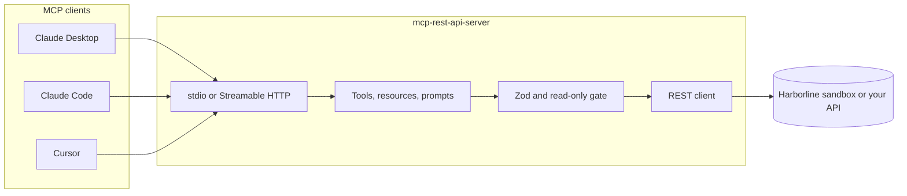

# mcp-rest-api-server

[](https://github.com/mustafaautomation/mcp-rest-api-server/actions/workflows/ci.yml)
[](LICENSE)

> Portfolio demo, not client work. Built by [Mustafa](https://github.com/mustafaautomation) as a reference template for wrapping any REST API as a Model Context Protocol server. The Harborline API in this repo is fictional sandbox data.

[Live page](https://mcp-api.quvantic.com) · [GitHub](https://github.com/mustafaautomation/mcp-rest-api-server) · [Offer](docs/OFFER.md)

A TypeScript MCP server Claude Desktop, Claude Code, and Cursor can launch. Stdio and Streamable HTTP, Zod, cursor pagination, retries, and a read-only switch. Leave `API_BASE_URL` unset and the CLI boots the Harborline sandbox. No external account.


## 60-second quickstart

```bash
git clone https://github.com/mustafaautomation/mcp-rest-api-server.git
cd mcp-rest-api-server
npm install
npm run build
node dist/cli.js --help
npm run demo
```

Point Claude Desktop, Claude Code, or Cursor at the built CLI. Config snippets are in `docs/configs/`. For a checkout that is not published to npm yet:

```json
{
  "mcpServers": {
    "harborline": {
      "command": "node",
      "args": ["/absolute/path/to/mcp-rest-api-server/dist/cli.js"],
      "env": { "MCP_READ_ONLY": "true" }
    }
  }
}
```

The hosted read-only demo, once this repo is deployed at the apex domain, is `https://mcp-api.quvantic.com/mcp`. It serves the same sandbox. It does not accept writes.

The package is publish-ready (`npx mcp-rest-api-server`) and has not been published from this repo.

## Adapt to your API in 15 minutes

1. Set `API_BASE_URL` and a read-only `API_KEY`. The sandbox steps aside.
2. Replace the Zod objects in `src/api/schemas.ts` with your JSON.
3. Map each endpoint to a method on `src/api/client.ts`. Tools do not call `fetch`.
4. Register the tools in `src/mcp/tools.ts`. Leave write tools under the `config.readOnly` check.
5. `npm test`, then paste a config from `docs/configs/`.

Page-number APIs stay behind `cursorToPage` / `pageToCursor` in `src/api/pagination.ts`. The model still sends `cursor` and `limit`. The longer walkthrough is [docs/ADAPT.md](docs/ADAPT.md).

## Architecture



stdout is the protocol. Logs go to stderr. The API key is read from the environment, attached as `Authorization: Bearer` or `x-api-key`, and scrubbed from log lines and tool errors.

The server uses `@modelcontextprotocol/sdk` 1.32.2, the latest release of that package. It speaks MCP `2025-11-25`.

## Tools

Read tools are always registered.

| Tool | What it does |
| --- | --- |
| `get_workspace_summary` | Counts of projects, tasks, and contacts |
| `list_projects` | One page of projects |
| `get_project` | One project by id |
| `list_tasks` | Tasks, filterable by project, status, assignee |
| `get_task` | One task by id |
| `list_contacts` | Contacts, with an optional search string |
| `get_contact` | One contact by id |

Write tools are registered only when the server is started with `--read-write` or `MCP_READ_ONLY=false`.

| Tool | What it does |
| --- | --- |
| `create_task` | Create a task on an existing project |
| `update_task` | Patch one or more fields |
| `create_contact` | Create a contact. Email must be unique |

The REST client also refuses `POST` and `PATCH` while read-only is on. A new write tool cannot bypass the flag by forgetting the check.

List tools take `limit` (1–100, default 20) and `cursor`. The result includes `nextCursor` and `hasMore`. Pass `nextCursor` back as `cursor`. Omit it to start over. Cursors are opaque. Don't invent them.

### Resources

| URI | Body |
| --- | --- |
| `harborline://workspace/summary` | Live counts, plus the server's read-only flag |
| `harborline://contract` | Auth, pagination, and the endpoint list. No live API key |
| `harborline://projects/{projectId}` | One project and its tasks |

### Prompts

| Prompt | Arguments | What the model receives |
| --- | --- | --- |
| `project-status-brief` | `projectId` | A brief grounded in the live project and tasks |
| `client-update-email` | `projectId`, optional `tone` | A short email. Tone is `plain`, `warm`, or `formal` |

## Configure

Copy `.env.example`. Real environment variables win over the file. Shell flags win over both.

| Variable | Default | Role |
| --- | --- | --- |
| `API_BASE_URL` | embedded sandbox | Upstream origin. Required for a real API |
| `API_KEY` | `sandbox-demo-key` for the sandbox | Required once `API_BASE_URL` is set |
| `API_AUTH_STYLE` | `bearer` | `bearer`, `api-key`, or `both` |
| `API_KEY_HEADER` | `x-api-key` | Header used for `api-key` and `both` |
| `MCP_READ_ONLY` | `true` | `false` registers write tools |
| `API_TIMEOUT_MS` | `10000` | Per-attempt timeout |
| `API_MAX_RETRIES` | `3` | Extra attempts after the first |
| `API_RETRY_BASE_MS` | `200` | Backoff base. Jitter is full |
| `API_RETRY_MAX_MS` | `8000` | Cap, including `Retry-After` |
| `API_RATE_LIMIT_RPS` | `10` | Token bucket refill |
| `API_RATE_LIMIT_BURST` | `20` | Burst shared by the process |
| `MCP_HTTP_HOST` | `127.0.0.1` | HTTP bind host |
| `MCP_HTTP_PORT` | `8787` | HTTP bind port |
| `MCP_HTTP_TOKEN` | unset | Bearer token required on `/mcp` when set |
| `LOG_LEVEL` | `info` | `debug`, `info`, `warn`, `error`, `silent` |

`--api-key` exists and should be avoided. Flags are visible to other users on the machine. Put the key in the environment.

Retries: GET retries on 408, 429, 5xx, timeouts, and network errors. POST and PATCH retry on 408, 429, and connection failures that never left the machine (`ECONNREFUSED`, `ENOTFOUND`). A 500 on a write is returned once. `Retry-After` is honored up to `API_RETRY_MAX_MS`.

Errors from tools look like this:

```json
{
  "error": {
    "code": "not_found",
    "message": "Project prj_missing was not found.",
    "status": 404,
    "requestId": "req_ab12cd34",
    "retryable": false
  }
}
```

Codes: `unauthorized`, `not_found`, `validation`, `rate_limited`, `conflict`, `upstream`, `timeout`, `network`, `read_only`.

## Clients

Stdio is the path all three clients launch. The snippets in `docs/configs/` use `npx`. Until the package is on npm, point `command` at Node and `args` at `dist/cli.js`.

### Claude Desktop

`~/Library/Application Support/Claude/claude_desktop_config.json` on macOS, `%APPDATA%\Claude\claude_desktop_config.json` on Windows. See `docs/configs/claude-desktop.json`.

```json
{
  "mcpServers": {
    "harborline": {
      "command": "npx",
      "args": ["-y", "mcp-rest-api-server"],
      "env": {
        "API_BASE_URL": "https://api.example.com",
        "API_KEY": "YOUR_API_KEY",
        "MCP_READ_ONLY": "true"
      }
    }
  }
}
```

Local checkout, sandbox included:

```json
{
  "mcpServers": {
    "harborline": {
      "command": "node",
      "args": ["/absolute/path/to/mcp-rest-api-server/dist/cli.js"],
      "env": { "MCP_READ_ONLY": "true" }
    }
  }
}
```

### Claude Code

Project file `.mcp.json`, or user scope. See `docs/configs/claude-code.mcp.json`.

```json
{
  "mcpServers": {
    "harborline": {
      "type": "stdio",
      "command": "npx",
      "args": ["-y", "mcp-rest-api-server"],
      "env": {
        "API_BASE_URL": "https://api.example.com",
        "API_KEY": "YOUR_API_KEY",
        "MCP_READ_ONLY": "true"
      }
    }
  }
}
```

```bash
claude mcp add harborline \
  -e API_BASE_URL=https://api.example.com \
  -e API_KEY=YOUR_API_KEY \
  -e MCP_READ_ONLY=true \
  -- npx -y mcp-rest-api-server
```

### Cursor

`~/.cursor/mcp.json` or `.cursor/mcp.json` in the project. See `docs/configs/cursor.mcp.json`.

```json
{
  "mcpServers": {
    "harborline": {
      "command": "npx",
      "args": ["-y", "mcp-rest-api-server"],
      "env": {
        "API_BASE_URL": "https://api.example.com",
        "API_KEY": "YOUR_API_KEY",
        "MCP_READ_ONLY": "true"
      }
    }
  }
}
```

### Streamable HTTP

```bash
node dist/cli.js http --port 8787
```

The process listens on `127.0.0.1` and checks the `Host` header. Bind `0.0.0.0` only when you set `MCP_HTTP_TOKEN`. The MCP endpoint is `POST /mcp` and answers JSON. `GET /health` is unauthenticated so a probe can use it.

```bash
MCP_HTTP_TOKEN=choose-a-long-token node dist/cli.js http --host 0.0.0.0 --port 8787
```

`docs/configs/streamable-http.json` shows the client side. Inspector:

```bash
npx @modelcontextprotocol/inspector --cli node dist/cli.js --method tools/list
npx @modelcontextprotocol/inspector --cli node dist/cli.js \
  --method tools/call --tool-name list_projects --tool-arg limit=2
```

`npm run demo` drives the same server with the official SDK client and prints a page of projects, a resource, and a prompt. A recording of that session is in `docs/demo.gif`. Regenerate it with `vhs docs/demo.tape` after `npm run build`.

## Harborline sandbox

Fictional studio ops: six projects, sixteen tasks, eight contacts. The public demo key is `sandbox-demo-key`. It is not a credential for anything else.

```bash
node dist/cli.js mock --port 8788
curl -s localhost:8788/v1/projects?limit=2 -H "Authorization: Bearer sandbox-demo-key"
```

`GET /health` does not require a key. Everything under `/v1` does, via bearer or `x-api-key`.

## Docker

```bash
docker build -t mcp-rest-api-server .
docker run --rm -p 8787:8787 mcp-rest-api-server
```

The image serves Streamable HTTP on `0.0.0.0:8787` and boots the sandbox inside the container. Pass `API_BASE_URL` and `API_KEY` to use a real API, and `MCP_HTTP_TOKEN` before the port is reachable beyond your machine.

```bash
docker run --rm -p 8787:8787 \
  -e API_BASE_URL=https://api.example.com \
  -e API_KEY=YOUR_API_KEY \
  -e MCP_READ_ONLY=true \
  -e MCP_HTTP_TOKEN=choose-a-long-token \
  mcp-rest-api-server
```

## Scripts

| Script | What it does |
| --- | --- |
| `npm run dev` | Run the CLI from TypeScript |
| `npm test` | Vitest. Unit tests plus integration against the sandbox |
| `npm run lint` | ESLint |
| `npm run typecheck` | `tsc` on `src`, `tests`, and `scripts` |
| `npm run build` | Emit `dist/` |
| `npm run demo` | Client session recorded in `docs/demo.gif` |
| `npm start` | `node dist/cli.js` |

CI (`.github/workflows/ci.yml`) runs lint, typecheck, test, and build on Node 22, then builds the Docker image and curls `/health`.

## Publish

The `bin` entry is `mcp-rest-api-server`. `npm pack` runs the build. This checkout has not been published. When you publish from a machine that has npm credentials:

```bash
npm whoami
npm publish --access public
```

Confirm the name `mcp-rest-api-server` is still free first. No token is stored in this repo.

## Landing page and hosted demo

Deploy the **repository root** on Vercel (Hobby is enough). The build copies `site/` to `public/` and publishes two functions:

| Path | What it is |
| --- | --- |
| `/` | Landing page |
| `/mcp` | Read-only Streamable HTTP demo. JSON responses, sandbox data, no API key to configure |
| `/health` | Liveness JSON |

1. Import the repository in Vercel, or upload a prebuilt folder. Root Directory is the project root. Framework preset: Other.
2. From git, the build command in `vercel.json` is `npm run vercel-build`. A direct upload can skip that compile: ship `api/`, `public/`, `dist/`, and a `package.json` whose only dependencies are the public packages `@modelcontextprotocol/sdk`, `hono`, and `zod`, and set the build command to empty. Vercel still runs `npm install`.
3. Add the domain `mcp-api.quvantic.com`.
4. Connect a client to `https://mcp-api.quvantic.com/mcp`.

The function is stateless and answers in one POST, with `maxDuration` of 10 seconds, which fits the Hobby plan. Do not point the hosted demo at a real API key. Writes stay off. A separate `site/` root directory serves the page only and does not include `/mcp`.

## FAQ

**Is this a client project?**
No. Portfolio demo. Harborline is fictional.

**Does the model see my API key?**
No. The key is an environment variable. Tool errors and logs scrub it.

**Can it create records?**
Only when you start it with `--read-write` or `MCP_READ_ONLY=false`. The hosted demo does not.

**What if my API uses page numbers?**
Keep the tool arguments as `cursor` and `limit`. Translate inside the REST client. See [docs/ADAPT.md](docs/ADAPT.md).

**Which clients?**
Claude Desktop, Claude Code, and Cursor over stdio. Anything that speaks Streamable HTTP can use `/mcp`.

**Where do I hire this?**
[docs/OFFER.md](docs/OFFER.md). Three fixed-price packages.

## Layout

```
src/cli.ts            stdio, http, and mock commands
src/server.ts         MCP server factory
src/api/client.ts     auth, pagination, rate limit, retries
src/mcp/              tools, resources, prompts
src/mock/             Harborline sandbox
docs/ADAPT.md         replace Harborline with your API
docs/OFFER.md         Fiverr gig and Upwork opening
docs/configs/         copy-paste client config
site/                 landing page
```

## License

MIT. Copyright Mustafa.
